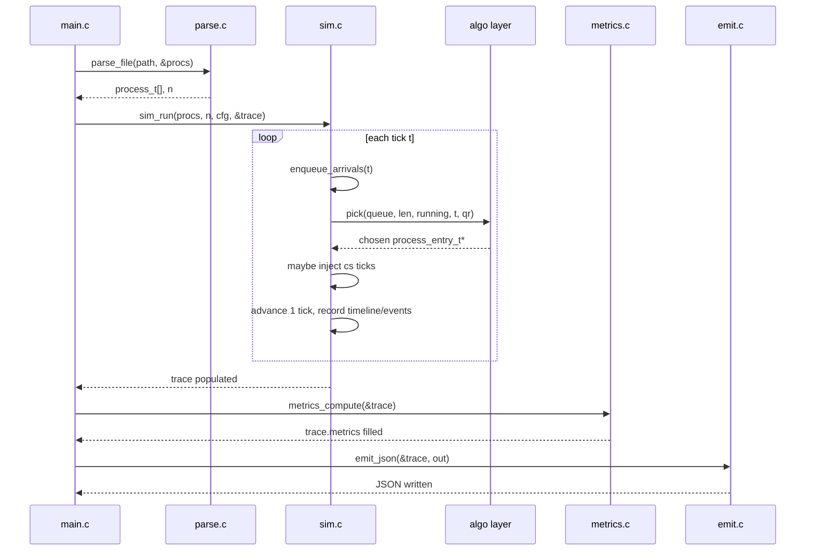

# Design Document: CPU Process Scheduler Simulator

## Overview

A tick-based CPU scheduling simulator written in C11 that reads a workload description
from a plain-text file, runs one of six scheduling algorithms (FCFS, SJF, SRTF, Priority,
Priority-P, RR) and emits a structured JSON trace suitable for visualisation in a
zero-dependency HTML/JS viewer.  Every 1 ms tick the simulator (1) enqueues newly arrived
processes, (2) selects the next process via the chosen algorithm, (3) advances that process
by one tick (optionally injecting context-switch penalty ticks), and (4) records the event.
The viewer loads the JSON and renders a Gantt chart, per-process metrics table, and an
event log—entirely from vanilla HTML/CSS/JS with no build step.

The project is intentionally self-contained: one C translation unit per module, a single
`Makefile`, and a single `viewer.html`.  This keeps the implementation auditable for an OS
course evaluation.

---

## Architecture (High-Level)

### System Context

```
┌─────────────────────────────────────────────────────────────────┐
│                          User / CLI                             │
│  scheduler --algo rr --input procs.txt --quantum 4 --out t.json │
└────────────────────────────┬────────────────────────────────────┘
                             │ argc / argv
                             ▼
┌─────────────────────────────────────────────────────────────────┐
│                        scheduler (main.c)                       │
│  ┌──────────┐  ┌──────────┐  ┌────────────┐  ┌─────────────┐  │
│  │  parser  │  │ sim core │  │  algo layer│  │  emitter    │  │
│  │ (parse.c)│  │  (sim.c) │  │ (algos/*.c)│  │  (emit.c)   │  │
│  └──────────┘  └──────────┘  └────────────┘  └─────────────┘  │
└────────────────────────────┬────────────────────────────────────┘
                             │ trace_t *
                             ▼
                    ┌─────────────────┐
                    │   out.json      │  (file or stdout)
                    └────────┬────────┘
                             │ fetch / drag-drop
                             ▼
                    ┌─────────────────┐
                    │  viewer.html    │  (browser, no server)
                    └─────────────────┘
```

### Module Breakdown

| Module | File(s) | Responsibility |
|--------|---------|----------------|
| **CLI / entry** | `main.c` | Parse `argv`, validate flags, orchestrate pipeline |
| **Input parser** | `parse.c` / `parse.h` | Read process file, strip comments, validate integers |
| **Simulation core** | `sim.c` / `sim.h` | Tick loop, ready-queue management, context-switch injection, timeline/event recording |
| **Algorithm layer** | `algos/fcfs.c`, `sjf.c`, `srtf.c`, `priority.c`, `priority_p.c`, `rr.c` + `algos/algo.h` | Stateless `pick()` functions implementing each scheduling policy |
| **Metrics** | `metrics.c` / `metrics.h` | Post-simulation aggregation of per-process and global statistics |
| **JSON emitter** | `emit.c` / `emit.h` | Serialise `trace_t` to JSON without external libs |
| **Viewer** | `viewer.html` | Browser-side Gantt + metrics visualisation, pure JS |

### Data Flow

```
argv ──► [cli_parse] ──► config_t
                              │
input_file ──► [parse_file] ──► process_t[]  (N processes)
                                    │
                         config_t + process_t[]
                                    │
                              [sim_run]
                           ┌────────────────────────────────┐
                           │  for t = 0 .. T_max:           │
                           │    enqueue_arrivals(t)          │
                           │    pick() via algo vtable       │
                           │    if new pid: inject cs ticks  │
                           │    advance 1 tick               │
                           │    record timeline + events     │
                           └────────────────────────────────┘
                                    │
                               trace_t *
                                    │
                           [metrics_compute] ──► fills trace.metrics
                                    │
                              [emit_json] ──► FILE *out
```

---

## Components and Interfaces (High-Level)

### Component: CLI (`main.c`)

**Purpose**: Validate and dispatch.

**Interface** (internal entry points called from `main`):

```c
/* Returns 0 on success, prints to stderr and returns 1 on error */
int  cli_parse(int argc, char **argv, config_t *cfg);
void usage(const char *prog);
```

**Responsibilities**:
- Map `--algo` string to `algo_id_t` enum
- Require `--quantum` when algo is `rr`, reject it for non-RR algos
- Default `--context-switch` to 0
- Open output file (or stdout when `--out` is absent)
- Call `parse_file`, `sim_run`, `metrics_compute`, `emit_json` in order
- On `--compare`: run all six algorithms on the same input and emit a comparison summary

---

### Component: Input Parser (`parse.c`)

**Purpose**: Turn a text file into a validated array of `process_t`.

**Interface**:

```c
/* Allocates *procs; caller must free().
   Returns number of processes, or -1 on error (message on stderr). */
int parse_file(const char *path, process_t **procs);
```

**Responsibilities**:
- Skip blank lines and lines whose first non-whitespace char is `#`
- Parse exactly 4 integers per line: pid, arrival, burst, priority
- Reject negative values, zero burst, duplicate pids
- Sort result by arrival (stable), then by pid for equal arrivals

---

### Component: Simulation Core (`sim.c`)

**Purpose**: Drive the tick loop; own the ready queue and running state.

**Interface**:

```c
/* Runs simulation; populates tr->timeline, tr->events, per-process start/completion.
   Returns 0 on success. */
int sim_run(const process_t *procs, int n, const config_t *cfg, trace_t *tr);
```

**Internal helpers** (static, not exposed in header):

```c
static void enqueue_arrivals(sim_state_t *s, int t);
static void push_ready(sim_state_t *s, process_entry_t *pe);
static process_entry_t *pick_next(sim_state_t *s, int t);
static void record_timeline(sim_state_t *s, int t_start, int t_end,
                             int pid, seg_type_t type);
static void record_event(sim_state_t *s, int t, event_type_t etype, int pid);
```

---

### Component: Algorithm Layer (`algos/`)

**Purpose**: Implement the scheduling decision as a pure function.

**Shared vtable contract** (`algos/algo.h`):

```c
typedef struct process_entry process_entry_t;   /* forward */

/* Returns pointer to the chosen entry in the ready queue, or NULL if empty.
   Must NOT modify the queue itself—sim core does that.
   `running` is the currently running entry (NULL if CPU idle).
   `t` is the current tick. `quantum_remaining` is RR-specific state. */
typedef process_entry_t *(*pick_fn_t)(
    process_entry_t **queue, int queue_len,
    process_entry_t  *running,
    int t,
    int quantum_remaining
);

typedef struct {
    algo_id_t  id;
    const char *name;
    pick_fn_t  pick;
    bool       preemptive;  /* sim core uses this to know when to re-call pick */
} algo_t;

extern const algo_t ALGO_FCFS;
extern const algo_t ALGO_SJF;
extern const algo_t ALGO_SRTF;
extern const algo_t ALGO_PRIORITY;
extern const algo_t ALGO_PRIORITY_P;
extern const algo_t ALGO_RR;
```

---

### Component: Metrics (`metrics.c`)

**Purpose**: Compute per-process and global metrics after simulation.

**Interface**:

```c
void metrics_compute(trace_t *tr);
```

---

### Component: JSON Emitter (`emit.c`)

**Purpose**: Serialise `trace_t` to the specified JSON schema with no external library.

**Interface**:

```c
/* Writes JSON to `out`. Returns 0 on success. */
int emit_json(const trace_t *tr, FILE *out);
```

---

## Data Models

### `process_t` — static per-process descriptor (input)

```c
typedef struct {
    int pid;
    int arrival;
    int burst;
    int priority;   /* lower number = higher priority */
} process_t;
```

### `process_entry_t` — mutable simulation state per process

```c
typedef struct process_entry {
    process_t  proc;          /* immutable copy of input */
    int        remaining;     /* burst ticks left */
    int        start_tick;    /* first tick the process runs (-1 = not yet) */
    int        completion_tick; /* tick after last run tick (t+1) */
    int        rr_pos;        /* insertion order into RR queue (tie-break) */
} process_entry_t;
```

### `config_t` — parsed CLI configuration

```c
typedef enum {
    ALGO_ID_FCFS = 0,
    ALGO_ID_SJF,
    ALGO_ID_SRTF,
    ALGO_ID_PRIORITY,
    ALGO_ID_PRIORITY_P,
    ALGO_ID_RR
} algo_id_t;

typedef struct {
    algo_id_t   algo;
    int         quantum;          /* RR quantum; 0 if not RR */
    int         context_switch;   /* penalty ticks, default 0 */
    const char *input_path;
    FILE       *out;              /* opened output stream */
    bool        compare_mode;
} config_t;
```

### `seg_type_t` / `timeline_seg_t` — Gantt timeline segment

```c
typedef enum { SEG_RUN, SEG_IDLE, SEG_CONTEXT_SWITCH } seg_type_t;

typedef struct {
    int       t_start;
    int       t_end;
    int       pid;    /* -1 for idle / context_switch */
    seg_type_t type;
} timeline_seg_t;
```

### `event_type_t` / `event_t` — simulation event log

```c
typedef enum {
    EVT_ARRIVE,
    EVT_DISPATCH,
    EVT_PREEMPT,
    EVT_COMPLETE
} event_type_t;

typedef struct {
    int         t;
    event_type_t type;
    int         pid;
    int        *ready_queue;   /* snapshot of pids in ready queue at event time */
    int         ready_queue_len;
} event_t;
```

### `metrics_t` — aggregate statistics

```c
typedef struct {
    double avg_waiting;
    double avg_turnaround;
    double avg_response;
    double cpu_utilization;   /* percentage */
    double throughput;        /* processes / tick */
    int    context_switches;  /* number of CS penalty insertions */
} metrics_t;
```

### `trace_t` — top-level simulation result

```c
typedef struct {
    const config_t    *cfg;
    const process_t   *procs;       /* original input array */
    int                n;

    /* per-process results (parallel to procs[]) */
    int               *start;       /* start_tick for each proc */
    int               *completion;  /* completion_tick for each proc */
    int               *waiting;     /* per-process waiting time */
    int               *turnaround;  /* per-process turnaround */
    int               *response;    /* per-process response time */

    timeline_seg_t    *timeline;
    int                timeline_len;

    event_t           *events;
    int                events_len;

    metrics_t          metrics;
} trace_t;
```

### `sim_state_t` — internal simulation state (not exposed)

```c
typedef struct {
    process_entry_t  *entries;       /* one per process, heap-allocated */
    int               n;

    process_entry_t **ready_queue;   /* pointer array, max n */
    int               ready_len;

    process_entry_t  *running;       /* currently on CPU, NULL = idle */
    int               last_pid;      /* pid dispatched in previous tick (-2 = none) */

    int               quantum_remaining;   /* ticks left in current RR quantum */
    int               cs_ticks_left;       /* context-switch countdown */

    /* growing arrays for output */
    timeline_seg_t   *timeline;
    int               timeline_len;
    int               timeline_cap;

    event_t          *events;
    int               events_len;
    int               events_cap;

    int               run_ticks;     /* total ticks CPU was running a process */
    int               context_switch_count;

    const config_t   *cfg;
    const algo_t     *algo;
} sim_state_t;
```

---

## Sequence Diagrams

### Main Happy-Path Flow



### Context-Switch Injection

```mermaid
sequenceDiagram
    participant S as sim core
    Note over S: tick t: running=P1, pick()=P2
    S->>S: cs_ticks_left = context_switch_cost
    loop cs_ticks_left > 0
        S->>S: record SEG_CONTEXT_SWITCH tick
        S->>S: enqueue_arrivals(t)   -- arrivals still processed
        S->>S: cs_ticks_left--; t++
    end
    S->>S: dispatch P2; record EVT_DISPATCH
    S->>S: record SEG_RUN tick
```

---

## Low-Level Design: Algorithmic Pseudocode

### Main Simulation Loop

```pascal
PROCEDURE sim_run(procs, n, cfg, tr)
  INPUT: procs — array of process_t
         n     — number of processes
         cfg   — config_t (algo, quantum, context_switch cost)
         tr    — trace_t to populate
  OUTPUT: 0 on success

  SEQUENCE
    // Initialise
    FOR i = 0 TO n-1 DO
      entries[i] ← make_entry(procs[i])
    END FOR

    s ← { entries, ready_queue=[], running=NULL, last_pid=-2,
          quantum_remaining=0, cs_ticks_left=0,
          run_ticks=0, cs_count=0 }

    t ← 0

    WHILE (not_all_done(s)) DO
      // Phase 1: context-switch drain
      IF s.cs_ticks_left > 0 THEN
        enqueue_arrivals(s, t)
        record_timeline_tick(s, t, -1, SEG_CONTEXT_SWITCH)
        s.cs_ticks_left ← s.cs_ticks_left - 1
        t ← t + 1
        CONTINUE
      END IF

      // Phase 2: enqueue arrivals at tick t
      enqueue_arrivals(s, t)

      // Phase 3: RR quantum expiry check (before pick)
      IF s.running ≠ NULL AND cfg.algo = RR THEN
        IF s.quantum_remaining = 0 THEN
          // Preempt: requeue AFTER new arrivals already enqueued above
          push_back(s.ready_queue, s.running)
          record_event(s, t, EVT_PREEMPT, s.running.proc.pid)
          s.running ← NULL
        END IF
      END IF

      // Phase 4: pick next process
      chosen ← s.algo.pick(s.ready_queue, s.ready_len, s.running, t,
                            s.quantum_remaining)

      IF chosen = NULL THEN
        // CPU idle
        record_timeline_tick(s, t, -1, SEG_IDLE)
        s.running ← NULL
        s.last_pid ← -2
        t ← t + 1
        CONTINUE
      END IF

      // Phase 5: context switch injection if pid changed
      IF chosen.proc.pid ≠ s.last_pid AND s.last_pid ≠ -2
         AND cfg.context_switch > 0 THEN
        remove_from_queue(s, chosen)
        s.running ← NULL
        s.cs_ticks_left ← cfg.context_switch
        s.context_switch_count ← s.context_switch_count + 1
        record_event(s, t, EVT_DISPATCH, chosen.proc.pid)
        // chosen will be dispatched after CS drain; stash chosen
        s.pending_dispatch ← chosen
        CONTINUE   // re-enter loop: drain CS ticks first
      END IF

      // Phase 6: dispatch (or continue running)
      IF chosen.proc.pid ≠ s.last_pid THEN
        remove_from_queue(s, chosen)
        IF chosen.start_tick = -1 THEN
          chosen.start_tick ← t
        END IF
        record_event(s, t, EVT_DISPATCH, chosen.proc.pid)
        s.running ← chosen
        s.last_pid ← chosen.proc.pid
        IF cfg.algo = RR THEN
          s.quantum_remaining ← cfg.quantum
        END IF
      END IF

      // Phase 7: run 1 tick
      s.running.remaining ← s.running.remaining - 1
      record_timeline_tick(s, t, s.running.proc.pid, SEG_RUN)
      s.run_ticks ← s.run_ticks + 1
      IF cfg.algo = RR THEN
        s.quantum_remaining ← s.quantum_remaining - 1
      END IF

      // Phase 8: completion check
      IF s.running.remaining = 0 THEN
        s.running.completion_tick ← t + 1
        record_event(s, t + 1, EVT_COMPLETE, s.running.proc.pid)
        s.running ← NULL
        s.last_pid ← -2
      END IF

      // Phase 9: preemption check for preemptive algos (non-RR)
      IF s.algo.preemptive AND s.running ≠ NULL THEN
        better ← s.algo.pick(s.ready_queue, s.ready_len, s.running, t+1, 0)
        IF better ≠ NULL AND is_better(better, s.running, s.algo) THEN
          push_back(s.ready_queue, s.running)
          record_event(s, t+1, EVT_PREEMPT, s.running.proc.pid)
          s.running ← NULL
          s.last_pid ← -2
        END IF
      END IF

      t ← t + 1
    END WHILE

    // Merge consecutive same-(type,pid) ticks into segments
    tr.timeline ← merge_timeline(s.timeline, s.timeline_len)
    tr.events   ← s.events
  END SEQUENCE
END PROCEDURE
```

---

### Tie-Breaking Rule (Applied in All Pickers)

```pascal
FUNCTION is_preferred(a, b)
  // Returns true if a should be chosen over b
  SEQUENCE
    IF a.proc.arrival < b.proc.arrival THEN RETURN true  END IF
    IF a.proc.arrival > b.proc.arrival THEN RETURN false END IF
    RETURN a.proc.pid < b.proc.pid
  END SEQUENCE
END FUNCTION
```

---

### Algorithm: FCFS

```pascal
FUNCTION fcfs_pick(queue, len, running, t, qr)
  // Non-preemptive: never displace running
  SEQUENCE
    IF running ≠ NULL THEN RETURN running END IF
    IF len = 0 THEN RETURN NULL END IF

    best ← queue[0]
    FOR i = 1 TO len-1 DO
      IF queue[i].proc.arrival < best.proc.arrival THEN
        best ← queue[i]
      ELSE IF queue[i].proc.arrival = best.proc.arrival
           AND queue[i].proc.pid < best.proc.pid THEN
        best ← queue[i]
      END IF
    END FOR
    RETURN best
  END SEQUENCE
END FUNCTION
```

---

### Algorithm: SJF (Non-Preemptive Shortest Job First)

```pascal
FUNCTION sjf_pick(queue, len, running, t, qr)
  // Non-preemptive: never displace running
  SEQUENCE
    IF running ≠ NULL THEN RETURN running END IF
    IF len = 0 THEN RETURN NULL END IF

    best ← queue[0]
    FOR i = 1 TO len-1 DO
      a ← queue[i]
      IF a.proc.burst < best.proc.burst THEN
        best ← a
      ELSE IF a.proc.burst = best.proc.burst THEN
        IF is_preferred(a, best) THEN best ← a END IF
      END IF
    END FOR
    RETURN best
  END SEQUENCE
END FUNCTION
```

---

### Algorithm: SRTF (Shortest Remaining Time First — Preemptive)

```pascal
FUNCTION srtf_pick(queue, len, running, t, qr)
  // Preemptive: pick globally shortest remaining from queue + running
  SEQUENCE
    best ← NULL

    IF running ≠ NULL THEN best ← running END IF

    FOR i = 0 TO len-1 DO
      a ← queue[i]
      IF best = NULL THEN
        best ← a
      ELSE IF a.remaining < best.remaining THEN
        best ← a
      ELSE IF a.remaining = best.remaining THEN
        IF is_preferred(a, best) THEN best ← a END IF
      END IF
    END FOR
    RETURN best
  END SEQUENCE
END FUNCTION
```

---

### Algorithm: Priority (Non-Preemptive)

```pascal
FUNCTION priority_pick(queue, len, running, t, qr)
  // Non-preemptive: never displace running
  SEQUENCE
    IF running ≠ NULL THEN RETURN running END IF
    IF len = 0 THEN RETURN NULL END IF

    best ← queue[0]
    FOR i = 1 TO len-1 DO
      a ← queue[i]
      IF a.proc.priority < best.proc.priority THEN
        best ← a
      ELSE IF a.proc.priority = best.proc.priority THEN
        IF is_preferred(a, best) THEN best ← a END IF
      END IF
    END FOR
    RETURN best
  END SEQUENCE
END FUNCTION
```

---

### Algorithm: Priority-P (Preemptive Priority)

```pascal
FUNCTION priority_p_pick(queue, len, running, t, qr)
  // Preemptive: pick highest priority from queue + running
  SEQUENCE
    best ← NULL

    IF running ≠ NULL THEN best ← running END IF

    FOR i = 0 TO len-1 DO
      a ← queue[i]
      IF best = NULL THEN
        best ← a
      ELSE IF a.proc.priority < best.proc.priority THEN
        best ← a
      ELSE IF a.proc.priority = best.proc.priority THEN
        IF is_preferred(a, best) THEN best ← a END IF
      END IF
    END FOR
    RETURN best
  END SEQUENCE
END FUNCTION
```

---

### Algorithm: Round Robin

```pascal
FUNCTION rr_pick(queue, len, running, t, qr)
  // Quantum management is handled by sim core before this call.
  // If running still has quantum remaining: keep it.
  // Otherwise: pick head of FIFO queue.
  SEQUENCE
    IF running ≠ NULL AND qr > 0 THEN
      RETURN running
    END IF
    IF len = 0 THEN RETURN NULL END IF
    RETURN queue[0]   // FIFO: sim core maintains insertion order
  END SEQUENCE
END FUNCTION

// Enqueueing rule in sim core for RR:
//   On new arrival at tick t: append to tail of queue
//   On quantum expiry at tick t:
//     (a) first append all arrivals at tick t (enqueue_arrivals)
//     (b) then append the preempted process to the tail
// This satisfies: "new arrivals enqueued BEFORE preempted process"
```

---

### Timeline Merging

```pascal
PROCEDURE merge_timeline(raw, raw_len, merged_out, merged_len_out)
  // Consecutive ticks with identical (type, pid) collapse into one segment
  SEQUENCE
    IF raw_len = 0 THEN
      merged_len_out ← 0
      RETURN
    END IF

    seg ← { t_start=raw[0].t, t_end=raw[0].t+1,
             pid=raw[0].pid, type=raw[0].type }
    out ← []

    FOR i = 1 TO raw_len-1 DO
      cur ← raw[i]
      IF cur.type = seg.type AND cur.pid = seg.pid THEN
        seg.t_end ← cur.t + 1    // extend
      ELSE
        out.append(seg)
        seg ← { t_start=cur.t, t_end=cur.t+1,
                 pid=cur.pid, type=cur.type }
      END IF
    END FOR
    out.append(seg)

    merged_out     ← out
    merged_len_out ← out.len
  END SEQUENCE
END PROCEDURE
```

---

### Metrics Computation

```pascal
PROCEDURE metrics_compute(tr)
  SEQUENCE
    total_waiting    ← 0
    total_turnaround ← 0
    total_response   ← 0
    last_completion  ← 0

    FOR i = 0 TO tr.n-1 DO
      p   ← tr.procs[i]
      s   ← tr.start[i]
      c   ← tr.completion[i]

      ta  ← c - p.arrival
      wt  ← ta - p.burst
      rsp ← s - p.arrival

      tr.turnaround[i] ← ta
      tr.waiting[i]    ← wt
      tr.response[i]   ← rsp

      total_turnaround ← total_turnaround + ta
      total_waiting    ← total_waiting + wt
      total_response   ← total_response + rsp

      IF c > last_completion THEN last_completion ← c END IF
    END FOR

    m ← tr.metrics
    m.avg_turnaround  ← total_turnaround / tr.n
    m.avg_waiting     ← total_waiting    / tr.n
    m.avg_response    ← total_response   / tr.n
    m.cpu_utilization ← (run_ticks / last_completion) * 100.0
    m.throughput      ← tr.n / (double) last_completion
    m.context_switches← tr.sim_state.context_switch_count
  END SEQUENCE
END PROCEDURE
```

---

### JSON Emission

```pascal
PROCEDURE emit_json(tr, out)
  // Hand-written JSON; no sprintf for floats—use snprintf with %.4f
  SEQUENCE
    fprintf(out, "{\n")
    fprintf(out, "  \"version\": \"1.0\",\n")
    fprintf(out, "  \"algo\": \"%s\",\n", tr.cfg.algo_name)

    IF tr.cfg.algo = RR THEN
      fprintf(out, "  \"quantum\": %d,\n", tr.cfg.quantum)
    ELSE
      fprintf(out, "  \"quantum\": null,\n")
    END IF

    fprintf(out, "  \"context_switch_cost\": %d,\n", tr.cfg.context_switch)

    // processes array
    fprintf(out, "  \"processes\": [\n")
    FOR i = 0 TO tr.n-1 DO
      p ← tr.procs[i]
      fprintf(out, "    { \"pid\":%d, \"arrival\":%d, \"burst\":%d, "
                   "\"priority\":%d, \"start\":%d, \"completion\":%d, "
                   "\"waiting\":%d, \"turnaround\":%d, \"response\":%d }",
              p.pid, p.arrival, p.burst, p.priority,
              tr.start[i], tr.completion[i],
              tr.waiting[i], tr.turnaround[i], tr.response[i])
      IF i < tr.n-1 THEN fprintf(out, ",") END IF
      fprintf(out, "\n")
    END FOR
    fprintf(out, "  ],\n")

    // timeline array
    fprintf(out, "  \"timeline\": [\n")
    FOR i = 0 TO tr.timeline_len-1 DO
      seg ← tr.timeline[i]
      type_str ← seg_type_to_str(seg.type)
      IF seg.pid ≥ 0 THEN
        fprintf(out, "    { \"t_start\":%d, \"t_end\":%d, "
                     "\"pid\":%d, \"type\":\"%s\" }",
                seg.t_start, seg.t_end, seg.pid, type_str)
      ELSE
        fprintf(out, "    { \"t_start\":%d, \"t_end\":%d, "
                     "\"pid\":null, \"type\":\"%s\" }",
                seg.t_start, seg.t_end, type_str)
      END IF
      IF i < tr.timeline_len-1 THEN fprintf(out, ",") END IF
      fprintf(out, "\n")
    END FOR
    fprintf(out, "  ],\n")

    // events array
    fprintf(out, "  \"events\": [\n")
    FOR i = 0 TO tr.events_len-1 DO
      ev ← tr.events[i]
      fprintf(out, "    { \"t\":%d, \"type\":\"%s\", \"pid\":%d, "
                   "\"ready_queue\":[",
              ev.t, evt_type_to_str(ev.type), ev.pid)
      FOR j = 0 TO ev.ready_queue_len-1 DO
        fprintf(out, "%d", ev.ready_queue[j])
        IF j < ev.ready_queue_len-1 THEN fprintf(out, ",") END IF
      END FOR
      fprintf(out, "] }")
      IF i < tr.events_len-1 THEN fprintf(out, ",") END IF
      fprintf(out, "\n")
    END FOR
    fprintf(out, "  ],\n")

    // metrics object
    m ← tr.metrics
    fprintf(out, "  \"metrics\": {\n")
    fprintf(out, "    \"avg_waiting\": %.4f,\n",     m.avg_waiting)
    fprintf(out, "    \"avg_turnaround\": %.4f,\n",  m.avg_turnaround)
    fprintf(out, "    \"avg_response\": %.4f,\n",    m.avg_response)
    fprintf(out, "    \"cpu_utilization\": %.4f,\n", m.cpu_utilization)
    fprintf(out, "    \"throughput\": %.6f,\n",      m.throughput)
    fprintf(out, "    \"context_switches\": %d\n",   m.context_switches)
    fprintf(out, "  }\n")
    fprintf(out, "}\n")
  END SEQUENCE
END PROCEDURE
```

---

## Key Functions with Formal Specifications

### `parse_file`

```c
int parse_file(const char *path, process_t **procs);
```

**Preconditions:**
- `path` is a non-NULL, null-terminated string pointing to a readable file
- `procs` is a non-NULL pointer to a `process_t *` (output parameter)

**Postconditions:**
- On success: `*procs` is a heap-allocated array of `n` validated processes; returns `n > 0`
- On error: `*procs` is NULL; returns `-1`; error message written to `stderr`
- All `proc.burst > 0`, all `proc.arrival >= 0`, all `proc.pid` are unique
- Result is sorted: `proc.arrival` ascending; equal arrivals sorted by `proc.pid` ascending

**Invariants:**
- For every line processed: either it is skipped (blank/comment) or exactly 4 integers are parsed

---

### `sim_run`

```c
int sim_run(const process_t *procs, int n, const config_t *cfg, trace_t *tr);
```

**Preconditions:**
- `procs` is a validated array of `n` processes (output of `parse_file`)
- `cfg->algo` is a valid `algo_id_t`; if `ALGO_ID_RR`, `cfg->quantum >= 1`
- `cfg->context_switch >= 0`
- `tr` is zeroed/allocated; caller owns `tr`

**Postconditions:**
- Every process has `start_tick >= proc.arrival` and `completion_tick > start_tick`
- Sum of all `SEG_RUN` tick durations equals sum of all `proc.burst`
- Timeline segments are non-overlapping, contiguous, covering `[0, last_completion)`
- `tr->metrics.context_switches` equals the number of `SEG_CONTEXT_SWITCH` groups inserted
- For RR: no process runs more than `cfg->quantum` consecutive ticks without being re-evaluated

**Loop Invariant (main tick loop):**
- At the start of each tick `t`: every process with `proc.arrival <= t` has either completed or is in `ready_queue` or is `running`
- `cs_ticks_left >= 0` at all times

---

### `metrics_compute`

```c
void metrics_compute(trace_t *tr);
```

**Preconditions:**
- All `tr->start[i]` and `tr->completion[i]` have been filled by `sim_run`
- `tr->n >= 1`

**Postconditions:**
- `tr->waiting[i] >= 0` for all `i` (cannot be negative by definition)
- `tr->metrics.cpu_utilization ∈ (0.0, 100.0]`
- `tr->metrics.avg_turnaround >= tr->metrics.avg_response` (turnaround ≥ response always)

---

### `emit_json`

```c
int emit_json(const trace_t *tr, FILE *out);
```

**Preconditions:**
- `tr` is fully populated (sim + metrics complete)
- `out` is an open, writable `FILE *`

**Postconditions:**
- Output is valid JSON conforming to schema version `"1.0"`
- `timeline` segments are in chronological order (`t_start` ascending)
- `events` are in chronological order (`t` ascending)
- Returns `0` on success; returns non-zero and writes to `stderr` on I/O error

---

## Error Handling

### Error Scenario 1: Invalid CLI flags

**Condition**: Unknown `--algo` value, missing `--input`, `--quantum` absent for RR, or
`--quantum` provided for non-RR algo.  
**Response**: Print `"error: <reason>"` to `stderr`, print `usage()`, exit with code `1`.  
**Recovery**: N/A — user must fix the command.

### Error Scenario 2: Malformed input file

**Condition**: Non-integer token, wrong number of fields, negative/zero burst, duplicate pid.  
**Response**: Print `"error: line N: <reason>"` to `stderr`, exit with code `1`.  
**Recovery**: N/A — user must fix the file.

### Error Scenario 3: Memory allocation failure

**Condition**: `malloc`/`realloc` returns `NULL`.  
**Response**: Print `"error: out of memory"` to `stderr`, exit with code `1`.  
**Recovery**: N/A — fatal.

### Error Scenario 4: Output file not writable

**Condition**: `fopen(out_path, "w")` returns `NULL`.  
**Response**: Print `"error: cannot open output file: <path>"` to `stderr`, exit with code `1`.  
**Recovery**: N/A.

---

## Testing Strategy

### Unit Testing Approach

Each module is tested with a small dedicated C test file compiled with the same flags.
A `make test` target runs all tests and checks exit codes.

Key unit test cases:
- `parse_file`: blank file, comment-only file, one valid process, duplicate pid, negative burst, extra/missing columns
- `sim_run` / FCFS: single process, two simultaneous arrivals, idle gap between processes
- `sim_run` / RR: quantum=1 with 3 processes (verify round-robin ordering, quantum expiry, new-arrival-before-preempted rule)
- `sim_run` / SRTF: preemption mid-burst, tie-break on remaining time
- `sim_run` / Priority-P: higher-priority arrival preempts running lower-priority
- Context-switch: verify CS segments inserted on every pid change, verify arrivals still enqueued during CS ticks
- `metrics_compute`: verify `waiting >= 0`, turnaround = completion - arrival
- `emit_json`: parse the output with a minimal JSON validator, check all required keys present

### Property-Based Testing Approach

**Property Test Library**: Manual, generated with parameterised C test harness (no external PBT lib per project constraint).

Key properties verified over random workloads:
1. **Completion**: Every process completes (no infinite loop)
2. **No Overlap**: Timeline segments do not overlap
3. **Coverage**: Timeline is contiguous from 0 to last_completion
4. **Burst Accounting**: Sum of `SEG_RUN` durations = sum of `proc.burst` for all processes
5. **FIFO Order (FCFS)**: For processes with the same arrival, lower pid always starts first
6. **Shortest First (SJF/SRTF)**: At every dispatch point, no process in the ready queue has a shorter burst/remaining
7. **RR Quantum**: No `SEG_RUN` run-segment for a given dispatch exceeds `quantum` ticks
8. **Metrics Bounds**: `0 <= waiting[i]`, `turnaround[i] >= response[i]`, `cpu_utilization <= 100.0`

### Integration Testing

End-to-end: compile, run `scheduler --algo <A> --input sample.txt --out /tmp/out.json`,
load `out.json` into the viewer, validate JSON schema, compare metrics against hand-computed
values for the sample workload below.

Sample workload (`sample.txt`):
```
# pid  arrival  burst  priority
1      0        8      3
2      1        4      1
3      2        2      2
4      3        1      4
```

Expected FCFS completion order: P1(8), P2(12), P3(14), P4(15).

---

## Performance Considerations

- All six algorithms are O(n) per tick (linear scan of ready queue). For the typical OS-lab
  workload (n ≤ 100, T ≤ 10 000 ticks) this is negligible.
- Timeline and event arrays use geometric reallocation (double capacity on overflow) to avoid
  O(n²) copy overhead on large traces.
- No heap allocation inside the tick loop after initial setup; only the growing arrays reallocate.

---

## Security Considerations

- Input file is read with `fgets` + `strtol`; no `scanf` with unbounded strings.
- `strtol` end-pointer is checked to reject trailing garbage.
- No shell invocation; no `system()` calls.
- Output path is opened with `fopen` before simulation starts; if it fails the process exits
  before any computation occurs.

---

## Dependencies

| Dependency | Version / Note |
|------------|---------------|
| C compiler | GCC, C11 (`-std=c11 -Wall -Wextra`) |
| C standard library | `stdio.h`, `stdlib.h`, `string.h`, `stdbool.h`, `math.h` only |
| Build system | `make` (GNU Make) |
| Viewer | Vanilla HTML5 / CSS3 / ES6 (no CDN, no modules, no build step) |
| External libraries | **None** |

---

## File/Directory Layout

```
cpu-scheduler-simulator/
├── Makefile
├── src/
│   ├── main.c
│   ├── parse.c        parse.h
│   ├── sim.c          sim.h
│   ├── metrics.c      metrics.h
│   ├── emit.c         emit.h
│   ├── types.h        (process_t, config_t, trace_t, etc.)
│   └── algos/
│       ├── algo.h     (pick_fn_t vtable, algo_t, extern declarations)
│       ├── fcfs.c
│       ├── sjf.c
│       ├── srtf.c
│       ├── priority.c
│       ├── priority_p.c
│       └── rr.c
├── tests/
│   ├── test_parse.c
│   ├── test_fcfs.c
│   ├── test_rr.c
│   ├── test_srtf.c
│   ├── test_priority_p.c
│   ├── test_cs.c      (context-switch tests)
│   └── test_metrics.c
├── samples/
│   └── sample.txt
└── viewer/
    └── viewer.html
```
